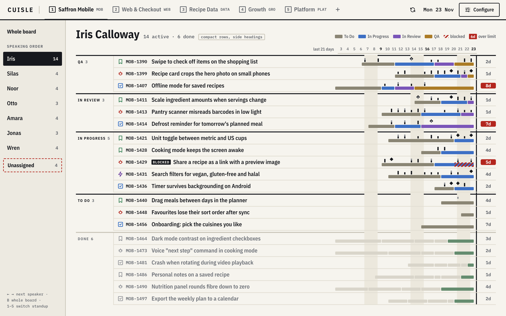
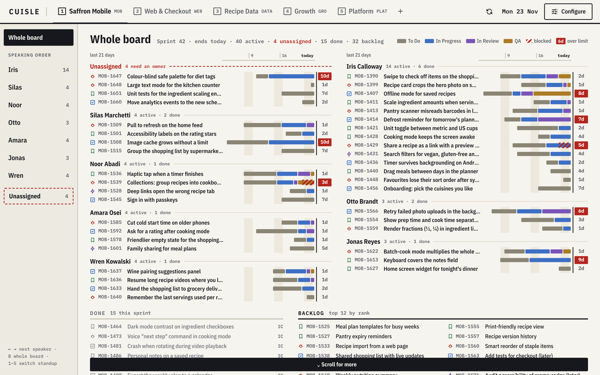
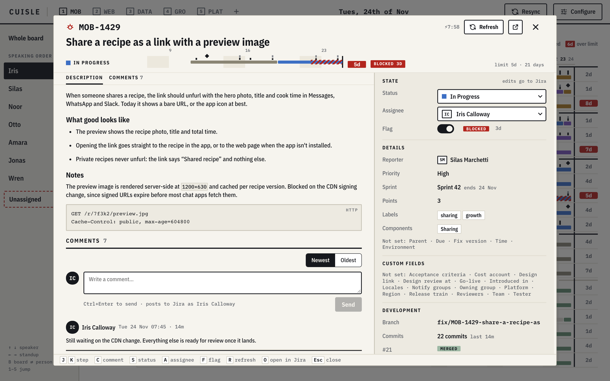
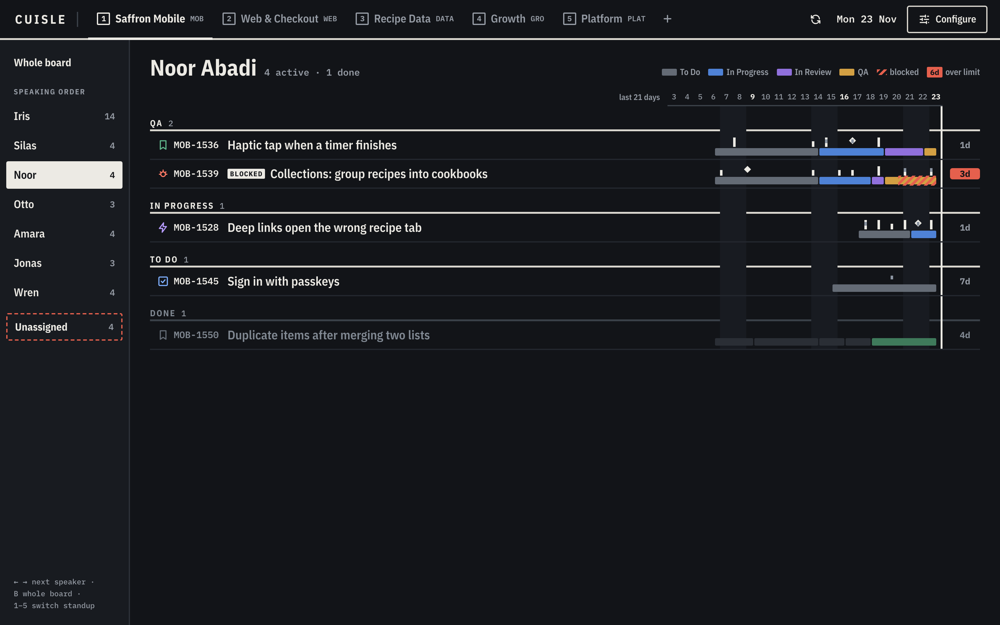
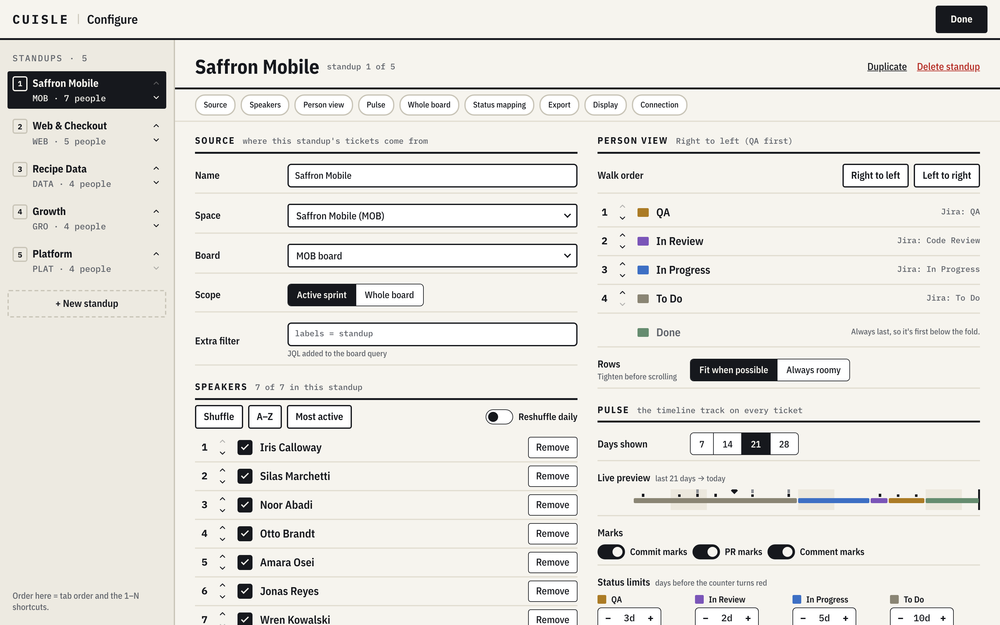

<p align="center"></p>

<h1 align="center">CUISLE</h1>

<p align="center"><strong>Run your daily standup from your Jira board: one screen per person, every ticket, and how it moved.</strong></p>

<p align="center">
  A fast desktop app for macOS, Windows and Linux. Your data stays on your machine.
</p>

<p align="center">
  <em>Cuisle</em> is Irish for "pulse", pronounced <strong>KISH-luh</strong> (/ˈkɪʃlʲə/).
</p>

<p align="center">
  <a href="https://crueber.github.io/cuisle/"><strong>Website</strong></a> ·
  <a href="https://github.com/crueber/cuisle/releases/latest"><strong>Download</strong></a>
</p>



<sub>All screenshots use invented data: a made-up recipe app called "Saffron" and invented people.</sub>

---

## What it is

Most standups are someone sharing a Jira board and scrolling while each person hunts for their tickets. Cuisle
replaces that with a screen built for the meeting:

- **One person at a time.** When it's Iris's turn, the screen shows *all* of Iris's tickets, grouped in the order you
  walk the board (QA, then Review, then In Progress, then To Do). Done tickets come last. Press `↓` for the next
  person.
- **A pulse track on every ticket.** A thin timeline of the last 7–28 days shows which lane the ticket sat in each
  day, when it was blocked, and when work happened: commits, pull requests and comments. "Stuck for a week" is
  visible at a glance, without anyone saying it.
- **Days in lane, flagged when too long.** Every ticket shows how long it's been in its current lane. The counter
  turns red past the limit you set for that lane.
- **The whole board on one screen.** A two-column overview of every person's work, with unassigned tickets first,
  plus what finished this sprint and the top of the backlog.
- **Find any ticket.** `⌘K` finds tickets by key or by words from the title, fuzzily, across every synced standup, and
  runs any command. It works offline, from what Cuisle has already synced.
- **Open any ticket in place.** A dense panel shows the description (images included), every comment, and all fields
  including custom ones. Move, reassign, flag or comment without leaving standup.
- **Several standups, one app.** Each team gets a tab. Press `1`–`9` to switch instantly.
- **Nothing is hidden to make things fit.** Rows tighten first. If there's still too much, the screen scrolls with
  a "Scroll for more" bar.
- **Legible over a screen share.** Big monospaced keys, high contrast, light and dark themes, and a Large (TV) text
  size for the conference-room screen.

## Screenshots

**The whole board.** Unassigned work first, then everyone in speaking order, then Done and the backlog.



**Any ticket, in place.** The description with images, every comment, all fields and the development activity. Change
the status, assignee or flag, or comment, without leaving standup.



**Dark theme.** It follows your system setting, or you can pick light or dark.



**Configure.** Every setting saves as you change it. There's no Save button.



## Install

Download the latest build from **[Releases](../../releases)**:

| Platform | File | First launch |
|---|---|---|
| macOS (Apple Silicon and Intel) | `.dmg` | The build is self-signed, not notarised. Right-click **Cuisle.app → Open → Open**, or use **System Settings → Privacy & Security → Open Anyway**. |
| Windows | installer `.exe` | SmartScreen → **More info → Run anyway** (the installer is self-signed). |
| Linux | `.AppImage` or `.deb` | `chmod +x Cuisle-*.AppImage`. Your API token is stored through the Secret Service, so GNOME Keyring or KWallet must be running. |

Each release includes `SHA256SUMS.txt` so you can verify your download.

## Getting started

1. **Connect to Jira Cloud.** Enter your site (`https://your-team.atlassian.net`), your Atlassian email and an
   [API token](https://id.atlassian.com/manage-profile/security/api-tokens). The token goes straight into your OS
   keychain.
2. **Create a standup.** Pick a space (project) and a board. Cuisle maps the board's columns to lanes automatically.
   Adjust the mapping in **Status mapping** if your workflow is unusual.
3. **Sync.** Press **Resync** or `R`. The first sync of a board takes a moment. The header shows progress, and later syncs
   only fetch what changed.
4. **Run the meeting.** Start on the whole board or the first speaker, and press `↓` as each person finishes.

Speakers come from the board: anyone with tickets on it. You can reorder them, shuffle them (optionally every day),
sort by most active, leave someone out for a day, remove them, or add someone who has no tickets yet.

### Keyboard

| Key | Action |
|---|---|
| `↑` `↓` | Previous / next speaker (the whole board sits after the last speaker) |
| `←` `→` | Previous / next standup |
| `B` | Whole board; press again right away to return to the person you left |
| `G` | On the whole board: group by Assignee or by Status (remembered per standup) |
| `+` `-` `0` | Zoom the screen in, out, or back to 100% (also with `⌘`/`Ctrl`); the header does not zoom |
| `1`–`9` | Switch standup |
| `R` / `Shift+R` | Sync changes / full resync |
| `⌘K` / `Ctrl+K`, `T` | Find a ticket by key or title, or run a command (the command palette: `>` commands, `#` tickets, `@` people) |
| `/` | Standup switcher |
| `,` | Configure |
| `?` | Key and pulse legend |
| `Esc` | Close a popover, or leave Configure |
| `Enter` | Open the focused ticket in Jira |

### Zoom

Hard to read from across the room? Press `+` (or use the `− 100% +` control in the title row) to zoom everything below the
header in, `-` to zoom out, `0` to reset. Zoom re-runs the layout rather than just magnifying: zoomed out, the whole board
goes to three columns and fits more; zoomed in, the rail shrinks, the columns drop to one and the person view tightens its
rows. Nothing is hidden, a bar says what is below. Each standup remembers its own zoom.

### Reading the pulse track

Each ticket's track covers the last 7, 14, 21 or 28 days (you choose), with today on the right:

- **Coloured bars** show the lane the ticket was in each day: To Do, In Progress, In Review, QA, Done. Weekends are
  shaded.
- **Red hatching** marks days it was blocked (a flag, or a status you mark as blocked).
- **Ticks above the bar** show work. A tall tick is a commit, a ◆ is a pull request event, and a small grey tick is a
  comment. Commits and PRs come from Jira's development information when your site has it.
- **The `3d` chip** is days in the current lane. It turns red past that lane's limit.

## Configure

Every control saves as you change it. Text fields save after a short pause. Highlights:

- **Source:** space, board, active sprint or whole board, plus an optional extra JQL filter (for example `labels = standup`).
- **Speakers:** order, include or exclude, shuffle daily, add or remove people, and where Unassigned goes (first, last or skip).
- **Person view:** the walk order of lanes, and whether rows tighten to fit or always stay roomy.
- **Pulse:** days shown, which marks to draw, per-lane day limits, weekend shading, and a live preview.
- **Whole board:** the Done window (sprint, 14 days or since yesterday) and how many backlog rows to show.
- **Status mapping:** board columns to lanes, including lanes you name yourself: type a new name in a column's lane
  box and choose *Create lane*. Your lanes work like In Progress (limits, walk order, the whole board) and get their own
  colour; any lane (and Done) can be renamed, and your own lanes deleted. When several columns share a lane, you choose
  their order.
- **Export:** send a standup to a folder as JSON (`cuisle.export.v1`) by hand or after every sync. No comment
  bodies, emails or secrets are ever exported.
- **Display:** light, dark or system theme. Standard or Large (TV) text. Sync on open (when stale, always or never).
  Check for updates daily (on by default) and Check now.
- **Updates:** when a newer release is out, an **Update** button appears in the header next to Resync. It shows what's
  new, then downloads the release for your system, checks it against the release's `SHA256SUMS.txt` (and its signature
  when there is one) and restarts into the new version. Copies from GitHub update from GitHub releases, copies from
  Forgejo from Forgejo releases. A `.deb` install opens the release page instead.

## Privacy and data

- **Local first.** Synced tickets and their history are kept in a SQLite database on your machine, so Cuisle opens
  instantly, works offline and builds up history over time. History is never pruned.
  - macOS: `~/Library/Application Support/Cuisle`
  - Windows: `%LOCALAPPDATA%\Cuisle`
  - Linux: `~/.local/share/cuisle`
- **No background traffic.** Cuisle only talks to Jira when you ask it to: Resync, sync on open (if enabled),
  leaving Configure after changing the source, searching while you type in a picker, or acting on a ticket you
  opened (refresh, change status, reassign, flag, comment). There's no polling and no telemetry. Unchanged tickets
  cost nothing to re-check: a sync with no changes is a handful of requests, whatever the board size.
- **No telemetry.** Once a day Cuisle asks GitHub or Forgejo, wherever you downloaded it, whether there's a newer
  release; nothing about you or your Jira data is sent. Turn it off in Configure → Display.
- **Secrets stay in the OS keychain.** Your API token is never written to the database, logs or exports.
- **Ticket content stays on your machine.** Descriptions, comments and images are stored locally so the ticket
  panel opens instantly and offline. They never appear in logs, exports or crash output.

## Build from source

You'll need:
- Go 1.27
- Node 24
- [Task](https://taskfile.dev)
- the Wails v3 CLI: `go install github.com/wailsapp/wails/v3/cmd/wails3@v3.1.0`
- on Linux, GTK 3 and WebKitGTK 4.1 headers (`libgtk-3-dev libwebkit2gtk-4.1-dev libsoup-3.0-dev`)

```sh
cd frontend && npm ci && cd ..
task dev        # the app against a built-in fake Jira, with hot reload; no account needed
task test       # Go (cgo-free) and frontend unit tests
task e2e        # Playwright: performance budgets, accessibility (axe, contrast), screenshots
task package    # a bundle for this OS in bin/
```

`task dev:mock` runs only the frontend, in a browser, against an in-memory mock.

### How it's built

- **Go + [Wails v3](https://v3.wails.io)** for the app shell.
- **Preact + Signals** for the UI. The only runtime dependencies are `preact`, `@preact/signals` and
  `@wailsio/runtime`.
- **Pure-Go SQLite** for storage, so no cgo is needed for tests.
- **Go computes, the UI lays out.** View models are built in Go, and the frontend only decides how they fit on screen.
- **Adapters, not hard-wiring.** Jira is one source adapter behind a small interface, and exports go through sink
  adapters (a JSON file sink ships today). Adding another tracker or destination doesn't touch the core.
- **Performance budgets are CI gates:**
  - cold start under 500 ms;
  - switching standups or people in under 50 ms;
  - the startup JS under 80 KB gzipped (lazy chunks such as the command palette under 20 KB).

The design and the reasoning behind it are in [`docs/`](docs):
- [product spec](docs/product-spec.md)
- [UX spec](docs/ux-spec.md)
- [architecture](docs/architecture.md)
- [data model](docs/data-model.md)
- [Jira sync](docs/jira-sync.md)
- [ADRs](docs/adr)

## Name

*Cuisle* (KISH-luh, /ˈkɪʃlʲə/; closer to KUSH-luh in southern Irish) is Irish for "pulse". The pulse track is the
heart of the app.

## License

[MIT](LICENSE).
